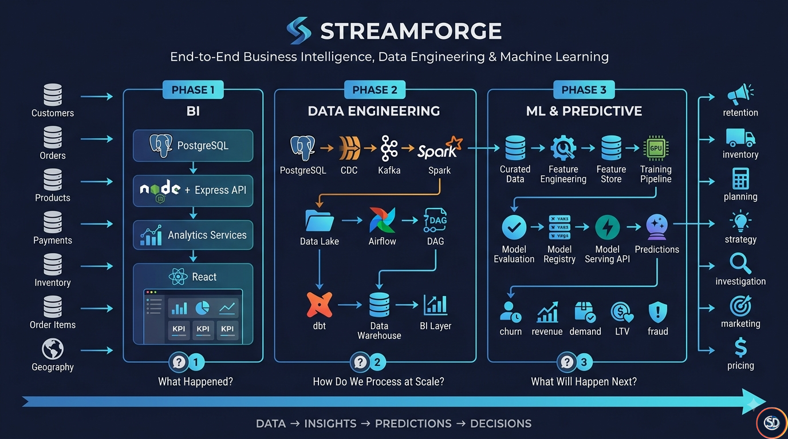

# StreamForge

<p align="center">
  
</p>

**An End to End Retail Data Engineering and Business Intelligence Platform**

StreamForge is a production inspired retail data platform that demonstrates how operational business data can be captured, processed, transformed and prepared for analytical reporting.

The project combines full stack development, PostgreSQL, change data capture, Apache Kafka, Apache Spark and dbt to build a modern data engineering architecture.

## 1. Business Problem

Retail businesses generate data across customers, products, orders, payments and inventory.

When this information is spread across systems, business teams can experience:

- Delayed reporting.
- Inconsistent business information.
- Slow inventory decisions.
- Limited customer insights.
- Difficulty monitoring sales performance.

StreamForge aims to provide a centralized data platform that transforms operational records into reliable analytical datasets.

## 2. Architecture

```text
Operational PostgreSQL
          |
          v
       Debezium
          |
          v
         Kafka
          |
          v
   Spark Structured Streaming
          |
          v
      Bronze Parquet
          |
          v
      Spark Silver
          |
          v
  PostgreSQL Silver Schema
          |
          v
      dbt Staging
          |
          v
      dbt Gold
          |
          v
   Business Intelligence
```

The architecture separates operational storage, event ingestion, data processing and analytical modelling.

The initial PostgreSQL Silver load and Gold warehouse are implemented. Continuous synchronization and automated orchestration remain under development.

## 3. Technology Stack

| Area | Technologies |
|---|---|
| Frontend | React, TypeScript, Material UI |
| Backend | Node.js, Express.js |
| Operational Database | PostgreSQL |
| Change Data Capture | Debezium |
| Event Streaming | Apache Kafka |
| Data Processing | Apache Spark |
| Data Lake Storage | Parquet |
| Transformation | dbt |
| Data Warehouse | PostgreSQL |
| Infrastructure | Docker, Docker Compose |
| Analytics | SQL, dimensional modelling |
| Version Control | Git, GitHub |

## 4. Implemented Features

### Operational Platform

- Retail relational database.
- Customer, product, order, order item and payment data.
- Backend REST API.
- Database migrations and seed data.

### Change Data Capture

- PostgreSQL logical replication configuration.
- Debezium PostgreSQL connector.
- Kafka topics for business entities.
- CDC event capture.

### Data Engineering

- Bronze raw event ingestion using Spark Structured Streaming.
- Parquet storage partitioned by source table and event date.
- Silver event processing.
- Current state datasets for five business entities.
- Data type handling and delete filtering.
- Initial Spark Silver to PostgreSQL Silver loading.

### Analytics Engineering

- Five dbt staging models.
- Customer dimension.
- Product dimension.
- Date dimension.
- Sales fact.
- Payment fact.
- Existing business marts.
- Data quality tests.

### Data Validation

The latest complete dbt test run passed all 68 tests with zero warnings and zero errors.

The current Silver datasets contain:

| Entity | Records |
|---|---:|
| Customers | 10,000 |
| Products | 500 |
| Orders | 100,000 |
| Order Items | 299,390 |
| Payments | 100,000 |
| Total | 509,890 |

## 5. Gold Data Warehouse

The Gold layer follows a star schema designed for analytical reporting.

### Dimensions

| Model | Grain |
|---|---|
| dim_customer | One row per customer |
| dim_product | One row per product |
| dim_date | One row per calendar date |

### Facts

| Model | Grain |
|---|---|
| fact_sales | One row per order item |
| fact_payment | One row per payment |

The sales fact contains quantity, unit price and calculated sales amount.

The payment fact contains payment amount, status and payment method.

## 6. Repository Structure

```text
streamforge/
├── backend/
├── frontend/
├── database/
│   ├── migrations/
│   ├── seeds/
│   └── docs/
├── dbt/
│   └── streamforge_analytics/
│       ├── models/
│       │   ├── staging/
│       │   └── marts/
│       ├── seeds/
│       └── macros/
├── streaming/
│   └── spark/
│       └── jobs/
├── warehouse/
├── infrastructure/
├── docker/
├── scripts/
├── data/
└── docs/
    ├── 01-business/
    ├── 02-requirements/
    ├── 03-architecture/
    ├── 04-api/
    ├── 05-database/
    ├── 06-deployment/
    ├── 07-testing/
    ├── 08-monitoring/
    ├── 09-decisions/
    ├── 10-roadmap/
    └── images/
```

## 7. Running the Project

### Start Infrastructure

From the project root:

```bash
docker compose up -d
```

Check running services:

```bash
docker compose ps
```

### Backend

```bash
cd backend
npm install
npm run dev
```

### dbt

```bash
cd dbt/streamforge_analytics

dbt debug
dbt parse
dbt run
dbt test
```

Configure the required database credentials and environment variables before running the services.

## 8. Documentation

Detailed technical documentation is available under `docs/`.

Important documents:

- Business problem and requirements.
- System architecture and data flow.
- Database design.
- Data warehouse design.
- dbt validation.
- Architecture decision records.

## 9. Current Limitations

The project is still under development.

- Continuous Spark Silver to PostgreSQL Silver synchronization is not implemented.
- Source delete propagation to PostgreSQL Silver needs implementation.
- Customer and product dimension keys need a stable strategy.
- Gold models currently use table materialization.
- Automated pipeline orchestration is not complete.
- Power BI dashboard integration is planned.
- Monitoring and recovery procedures need further development.

## 10. Roadmap

### Phase 1: Business Intelligence Platform

- Retail operational database.
- Backend REST APIs.
- Business analytics.
- Interactive frontend.

### Phase 2: Data Engineering Platform

- PostgreSQL change data capture.
- Debezium and Kafka integration.
- Spark Bronze and Silver processing.
- PostgreSQL Silver integration.
- dbt staging and Gold dimensional models.

### Phase 3: Production Data Platform

- Stable dimension key management.
- Continuous idempotent data synchronization.
- Delete propagation.
- Incremental warehouse transformations.
- Workflow orchestration.
- Monitoring and recovery.

### Phase 4: Business Intelligence

- Power BI or Tableau integration.
- Executive dashboards.
- Sales and payment reporting.
- Customer and product analytics.

## 11. Project Purpose

StreamForge is a practical engineering project intended to demonstrate full stack development, data engineering, analytics engineering, distributed data processing and dimensional modelling.

The long term objective is to build a complete retail data platform from operational transactions to business intelligence.
